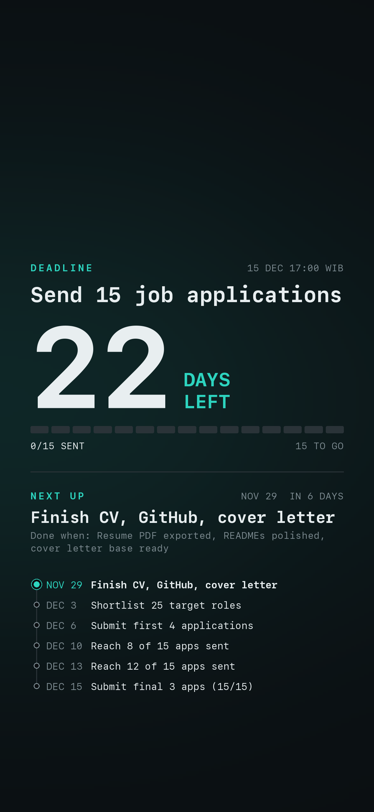
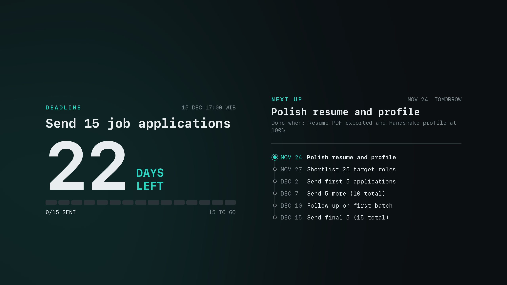

# Countdown lock screen: Send 15 job applications

Deadline: **15 Dec 2026, 17:00 WIB**. Plan in [plan.md](plan.md); everything else is driven by
[config.yaml](config.yaml).

<p align="center">
  
</p>



## Setup (once)

```sh
python3 -m venv .venv
.venv/bin/pip install Pillow PyYAML
```

## Regenerate everything

```sh
.venv/bin/python make_lockscreen.py            # out/*.png (iPhone, Android, desktop)
.venv/bin/python make_lockscreen.py --guides   # also out/preview/*_guides.png with safe zones + a mock clock
.venv/bin/python make_reminders.py             # reminders.ics
```

`make_lockscreen.py` exits with an error if any text or shape lands outside the safe zone
(top 30% and bottom 12% on phones are kept clear for the system clock and controls).

Preview another moment without touching `out/`:

```sh
.venv/bin/python make_lockscreen.py --today 2026-12-08 --out-dir /tmp/preview
.venv/bin/python make_lockscreen.py --today "2026-12-15 17:30" --out-dir /tmp/preview   # after the deadline
```

Once the deadline time has passed, the screen switches to DONE and stops showing a next milestone.

## Tests

```sh
.venv/bin/python -m unittest discover -s tests
```

Covers the countdown edge cases around the deadline time, the safe zone on every output for
every day of the plan, and the ICS format. The ICS parse test runs only if `icalendar` is installed.

## Updating progress

After each application, bump `progress.current` in `config.yaml` and re-run
`make_lockscreen.py`. Past milestones dim automatically and NEXT UP moves forward by date.

## Reminders

Google Calendar > Settings > Import & export > Import `reminders.ics`. You get a 08:00 WIB
reminder every day until the deadline (days left + next milestone) and an all-day event on
each milestone. Event UIDs stay the same across runs. Whether a re-import updates existing
events depends on the calendar app, so if you change milestones, delete the old events first.

## Re-render every morning (macOS)

One-line cron entry (`crontab -e`), runs at 07:00 local time:

```
0 7 * * * cd /path/to/countdown-lockscreen && .venv/bin/python make_lockscreen.py >/dev/null 2>&1
```

Cron only regenerates the PNGs; phones don't pick up new wallpaper files on their own. To
close the loop, sync `out/` to iCloud Drive and use an iOS Shortcuts personal automation
("Time of Day 07:05 > Get File > Set Wallpaper"), or re-set it by hand.

## Files

| File | What it is |
|------|------------|
| `plan.md` | Backward plan, 6 dated milestones with "done when" checks |
| `config.yaml` | Deadline, milestones, progress count, colors, fonts, output sizes |
| `make_lockscreen.py` | Pillow renderer (system fonts only, no network) |
| `make_reminders.py` | Writes `reminders.ics` (no extra dependency) |
| `out/` | Rendered PNGs; `out/preview/` holds safe-zone check images (don't submit those) |
